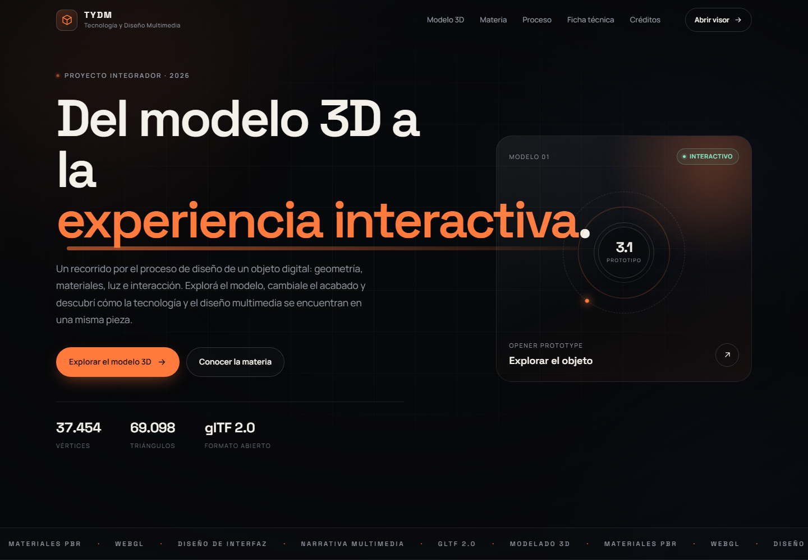
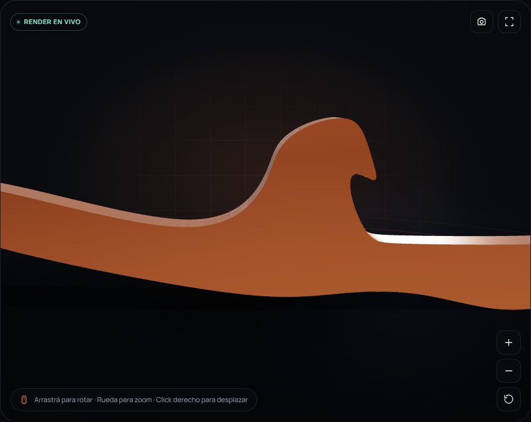
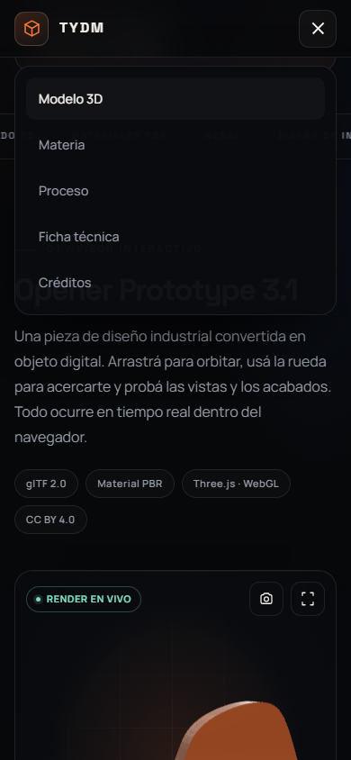

# TYDM · Tecnología y Diseño Multimedia
> **Del modelo 3D a la experiencia interactiva en tiempo real.**  
> Proyecto integrador — *Opener Prototype 3.1*.



---

## 🌟 Descripción

**TYDM (Tecnología y Diseño Multimedia)** explora la convergencia de la tecnología como herramienta, el diseño como método y la multimedia como lenguaje de interacción.

Este proyecto presenta una experiencia web interactiva en 3D construida sobre WebGL y Three.js, permitiendo a los usuarios inspeccionar, rotar, alterar materiales y capturar vistas en alta definición de un modelo de diseño industrial digitalizado: el **Opener Prototype 3.1**.

---

## 📸 Capturas

| Visor 3D Interactivo | Adaptación Mobile |
| :---: | :---: |
|  |  |

---

## 🚀 Características

- **Visor 3D interactivo en tiempo real**: Motor Three.js con soporte completo para mallas complejas y render PBR.
- **Controles de cámara de precisión**:
  - Órbita (arrastrar), paneo (clic derecho) y zoom progresivo (rueda o botones dedicados).
  - Vistas predeterminadas con transiciones cinemáticas suaves: *Isométrica*, *Frontal*, *Lateral* y *Superior*.
- **Selector de acabados y materiales**:
  - Acero cepillado
  - Grafito mate
  - Cobre pulido
  - Naranja técnico
  - Blanco hueso
- **Inspección de estructura (Wireframe)**: Alternancia en vivo para visualizar la topología de la malla poligonal.
- **Captura de pantalla en alta resolución**: Renderizado offscreen con plantilla tipográfica institucional y descarga automática en formato PNG.
- **Diseño responsivo y accesible**: Soporte para dispositivos táctiles, modo pantalla completa, y respeto estricto por `prefers-reduced-motion`.
- **Cero dependencias externas en tiempo de ejecución**: Three.js y sus extensiones empaquetados localmente en `./docs/vendor/`.

---

## 🛠️ Tecnologías utilizadas

- **HTML5 semántico** con metadatos Open Graph y accesibilidad (ARIA).
- **CSS3 moderno**: Custom properties, CSS Grid, Flexbox, backdrop-filter, animaciones fluidas.
- **JavaScript ES Modules (ESM)** nativo con `importmap`.
- **Three.js (r162+)**:
  - `OrbitControls`
  - `GLTFLoader`
  - `RoomEnvironment` & `PMREMGenerator`
  - Sombras suaves proyectadas (`PCFSoftShadowMap`) y sombras de contacto dinámicas.
- **glTF 2.0**: Formato estándar abierto para transmisión de escenas y modelos 3D (`.gltf` + `.bin`).

---

## 💻 Ejecución local

Debido a las políticas de seguridad de los navegadores (CORS para carga de archivos locales como `.gltf` y `.bin`), se requiere un servidor HTTP local para ejecutar la aplicación:

### Opción 1: Con Python (Recomendado)
```bash
# En la raíz del repositorio o dentro de /docs:
python3 -m http.server 8000
```
Abrí tu navegador en: [http://localhost:8000/docs/](http://localhost:8000/docs/) o [http://localhost:8000/](http://localhost:8000/)

### Opción 2: Con Node.js / npx
```bash
npx serve docs
```

### Opción 3: Con la extensión Live Server (VS Code)
Hacé clic derecho sobre `docs/index.html` y seleccioná **"Open with Live Server"**.

---

## 📁 Estructura del repositorio

```text
├── .gitignore
├── README.md
├── index.html                   # Redirección automática a /docs/
└── docs/                        # Directorio principal de la aplicación web
    ├── index.html               # Estructura de la página y layout del visor
    ├── styles.css               # Estilos, variables de diseño y adaptabilidad
    ├── app.js                   # Lógica de Three.js, controles y UI
    ├── models/
    │   ├── modelOpener/
    │   │   ├── scene.gltf       # Definición de la escena y nodos glTF
    │   │   └── scene.bin        # Buffers binarios de geometría y vértices
    │   └── opener_prototype3_1_final_fixed.zip
    ├── screenshots/             # Capturas para documentación
    └── vendor/                  # Three.js y addons oficiales (ES Modules)
```

---

## 🌐 Publicación en GitHub Pages

Para publicar este proyecto directamente en **GitHub Pages**:
1. Entrá a los **Settings** del repositorio en GitHub.
2. En el menú lateral, seleccioná **Pages**.
3. En **Build and deployment > Source**, seleccioná **Deploy from a branch**.
4. En **Branch**, elegí la rama `main` y la carpeta `/docs` (o `/root`).
5. Guardá los cambios. El sitio quedará publicado automáticamente en:
   `https://wsxdev.github.io/technology-and-multimedia-design/`

---

## 📄 Ficha técnica del modelo

- **Modelo**: Opener Prototype 3.1 Final Fixed
- **Geometría**: 37.454 vértices · 69.098 triángulos
- **Materiales**: PBR en tiempo real
- **Autor original**: [algl en Sketchfab](https://sketchfab.com/algl)
- **Licencia del modelo**: [Creative Commons Attribution 4.0 International (CC BY 4.0)](https://creativecommons.org/licenses/by/4.0/)

---

## ⚖️ Licencia y créditos

Este trabajo académico fue desarrollado para la cátedra **Tecnología y Diseño Multimedia**.  
El modelo 3D base está licenciado bajo [CC BY 4.0](https://creativecommons.org/licenses/by/4.0/).
